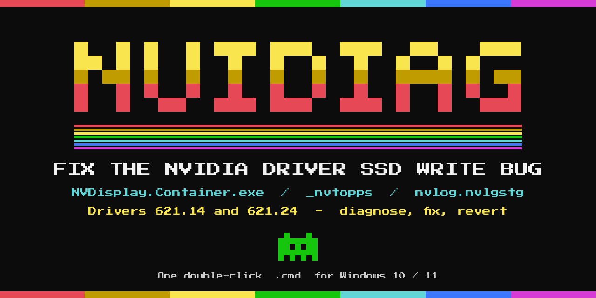
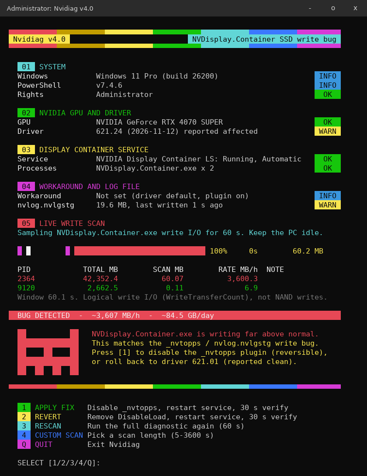
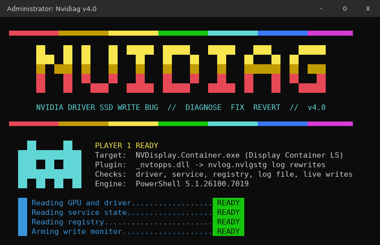
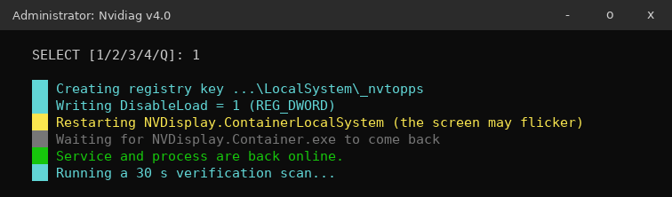
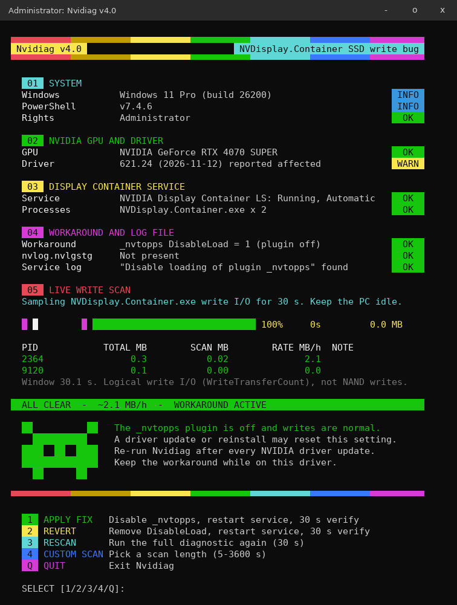

<p align="center">
  
</p>

<h1 align="center">Nvidiag</h1>

<p align="center">
  <b>Diagnose and fix the NVIDIA driver SSD write bug</b><br>
  <code>NVDisplay.Container.exe</code> constantly writing to your SSD &middot; <code>nvlog.nvlgstg</code> &middot; <code>_nvtopps</code> &middot; GeForce drivers 621.14 and 621.24
</p>

<p align="center">
  
  
  
  
  <a href="https://buymeacoffee.com/mchncd"></a>
</p>

---

Is **NVDisplay.Container.exe** showing **high disk usage** or **constant writes** in Task Manager or Resource Monitor, even when your PC is idle? Did it start after you installed **NVIDIA GeForce driver 621.14 or 621.24**? You are probably hit by the **NVIDIA driver SSD write bug**: the NVIDIA Display Container service keeps rewriting a log file called `nvlog.nvlgstg` and can burn through gigabytes, even terabytes, of **SSD write endurance (SSD wear / TBW)** for nothing.

**Nvidiag** is a single, open source, double-click `.cmd` tool for Windows that:

1. **Diagnoses** the bug: GPU and driver version, the NVIDIA Display Container LS service, the registry workaround, the `nvlog.nvlgstg` log file, and a **live measurement of how many MB per hour** `NVDisplay.Container.exe` writes.
2. **Fixes** it with the community workaround: it stops the Display Container from loading the optional `_nvtopps` plugin that writes the log (`DisableLoad = 1`), restarts the service and **verifies** the result with a new measurement.
3. **Reverts** the change with one key press, also verified.

No installer, no download of other tools, no telemetry, no network access. Read the code: it is one plain text file.

<p align="center">
  
</p>

## Contents

- [The bug](#the-bug-nvidia-display-container-rewrites-nvlognvlgstg)
- [Symptoms](#symptoms-am-i-affected)
- [Quick start](#quick-start)
- [What Nvidiag does](#what-nvidiag-does)
- [Command line usage](#command-line-usage)
- [How the fix works](#how-the-fix-works)
- [Safety and how to revert](#safety-and-how-to-revert)
- [Manual fix without Nvidiag](#manual-fix-without-nvidiag)
- [FAQ](#faq)
- [Compatibility](#compatibility)
- [Sources](#sources)
- [Disclaimer and license](#disclaimer)

## The bug: NVIDIA Display Container rewrites nvlog.nvlgstg

These facts come from public reports linked in [Sources](#sources). NVIDIA has not acknowledged the issue publicly at the time of writing (November 2026), and the 621.24 release notes list no such known issue.

- **Process:** `NVDisplay.Container.exe`, run by the Windows service **NVIDIA Display Container LS** (service name `NVDisplay.ContainerLocalSystem`). This service is installed with the driver and powers the NVIDIA Control Panel and the NVIDIA App.
- **File:** `C:\ProgramData\NVIDIA Corporation\nvtopps\nct\nvlog.nvlgstg`, a binary log.
- **What goes wrong:** the log is rewritten again and again instead of being appended to. The file itself stays around 20 MB, but every rewrite writes the whole file, so the write volume grows with uptime. A reboot or a service restart resets it, which is why reports range from a few GB to more than 100 GB per hour.
- **Who writes it:** according to the Display Container's own log, only one optional plugin writes this file: `_nvtopps.dll` ("NvTopps_Plugin").
- **Drivers:** first reported as new in GeForce Game Ready **621.14** (released 4 November 2026) and still present in **621.24** (released 12 November 2026). **621.01** is the last driver users report as clean. Not every PC on these drivers is affected.
- **Reported numbers:** about 515 MB of process writes per 5 minutes at idle on 621.14 (cross-checked with the SSD's own "Data Units Written" counter), about 3 GB per hour, up to 30 GB per hour on 621.24, and 120 to 160 GB per hour after about 43 hours of uptime on an RTX 4090. One XDA author saw **1.4 TB** of write I/O from `NVDisplay.Container.exe` after 5 days and 17 hours on 621.24.

The same `nvtopps` component already caused heavy writes in 2021 (the `nvtopps.db3` file, 471.x drivers). The 2026 issue is a different file and a new regression.

## Symptoms: am I affected?

- Task Manager > Details (add the "I/O write bytes" column) shows `NVDisplay.Container.exe` with gigabytes or terabytes written.
- Resource Monitor (`Win + R`, `resmon`, Disk tab) shows `NVDisplay.Container.exe` writing `nvlog.nvlgstg` every few seconds while the PC is idle.
- Your SSD's "Total Host Writes" / "Data Units Written" in CrystalDiskInfo or the vendor tool climbs much faster than usual.
- Some users also report stutter or hitching in games and video while the writes run.

Nvidiag checks all of this for you in about a minute.

## Quick start

1. **Download** [`nvidiag.cmd`](nvidiag.cmd) (open it on GitHub and press "Download raw file"), or download the repository as ZIP and extract it.
2. **Double-click** `nvidiag.cmd`.
3. Accept the **UAC prompt** (Administrator rights are needed to read the service state and to change the registry).
4. Keep the PC idle while the 60 second scan runs.
5. Read the verdict. If it says **BUG DETECTED**, press **1** to apply the fix. Press **2** at any time to revert.

<p align="center">
  
</p>

> If Windows SmartScreen or a "file downloaded from the internet" warning appears, right-click the file, choose Properties and tick **Unblock**, or choose "More info" and "Run anyway". The tool is a plain text batch file with embedded PowerShell, so you can open it in Notepad and read every line before running it.

## What Nvidiag does

| Step | What is checked | Why |
| --- | --- | --- |
| 01 System | Windows version, PowerShell version, Administrator rights | Context for bug reports |
| 02 GPU and driver | NVIDIA GPU name, driver version converted to NVIDIA format (for example `32.0.16.2124` = **621.24**) | Flags 621.14 and 621.24 as reported affected, 621.01 as reported clean |
| 03 Service | State and start type of **NVIDIA Display Container LS**, number of `NVDisplay.Container.exe` processes | The bug lives in this service |
| 04 Workaround and log | Registry value `DisableLoad` under `_nvtopps`, size and last write time of `nvlog.nvlgstg`, the "Disable loading of plugin" line in the service log | Shows whether the plugin is off and whether the log is still being written |
| 05 Live write scan | Logical write bytes of every `NVDisplay.Container.exe` process over the scan window, as MB per hour and GB per day | Proof of the bug on your PC, before and after the fix |

**Verdicts**

- **BUG DETECTED**: 500 MB per hour or more without the workaround. Clean systems are reported at under 2 MB per 5 minutes (under 25 MB per hour).
- **ELEVATED WRITES**: 50 to 500 MB per hour. The bug grows with uptime, so run a longer scan (menu 4) or scan again later.
- **ALL CLEAR**: below 50 MB per hour, with or without the workaround.
- **STILL HIGH WITH WORKAROUND**: the registry value is set but the writes did not stop; Nvidiag tells you what to check next.

**Menu**

| Key | Action |
| --- | --- |
| `1` | Apply fix: set `_nvtopps` `DisableLoad = 1`, restart the service, run a 30 s verification scan |
| `2` | Revert: remove `DisableLoad` (and the `_nvtopps` key if it is empty), restart the service, run a 30 s verification scan |
| `3` | Run the full diagnostic again |
| `4` | Custom scan length, 5 to 3600 seconds |
| `Q` | Quit |

<p align="center">
  <br><br>
  
</p>

## Command line usage

```bat
:: default 60 second scan
nvidiag.cmd

:: 5 minute scan, better for catching the bug soon after a reboot
nvidiag.cmd 300
```

The first argument is the scan length in seconds (5 to 3600, values outside are clamped). Nvidiag asks for Administrator rights itself and passes the argument through the UAC prompt. It uses PowerShell 7 (`pwsh`) if installed, otherwise the built-in Windows PowerShell 5.1, with `-ExecutionPolicy Bypass` for its own embedded code only.

## How the fix works

The NVIDIA Display Container loads a set of plugins and supports a per-plugin `DisableLoad` registry value. Its own log marks `_nvtopps.dll` as an optional plugin. Nvidiag sets:

```text
Key    HKLM\SYSTEM\CurrentControlSet\Services\NVDisplay.ContainerLocalSystem\Parameters\LocalSystem\_nvtopps
Value  DisableLoad   REG_DWORD   1
```

and restarts **NVIDIA Display Container LS**. After the restart the service log `C:\ProgramData\NVIDIA\NVDisplay.ContainerLocalSystem.log` shows `Disable loading of plugin ..._nvtopps.dll`, `nvlog.nvlgstg` is no longer created, and the write rate drops to almost zero. In the original NVIDIA forum report the service stayed on Automatic and the NVIDIA App kept working (a refresh rate change was tested).

What Nvidiag does **not** do: it does not disable or remove the NVIDIA service, does not delete driver files, does not delete or lock the log file, does not touch Control Panel settings and does not install anything.

## Safety and how to revert

- **One registry value.** The only change is `DisableLoad` under the `_nvtopps` key. Nvidiag creates the key only if it does not exist (it never recreates an existing key, which would wipe its values) and reads the value back to confirm.
- **One key to undo.** Menu **2** removes `DisableLoad`, removes the `_nvtopps` key only if it is then empty, restarts the service and measures again.
- **Driver updates.** A driver install or clean reinstall may reset the setting. Run Nvidiag again after every NVIDIA driver update, and revert once NVIDIA ships a fixed driver.
- **Screen flicker.** Restarting the Display Container service can make the screen flicker for a moment. Save your work first.
- **What you might lose.** NVIDIA does not document what `_nvtopps` does. Disabling it was reported to keep the NVIDIA App and Control Panel working, but not every feature (for example automatic GPU tuning, game optimization, DLSS or G-SYNC settings) has been tested by the community. If something you rely on stops working, press **2**.
- **Alternative.** The fix with zero side effects is rolling back to driver **621.01** with a clean install (NVIDIA Advanced Driver Search, Custom install, "Perform a clean installation").

## Manual fix without Nvidiag

Open PowerShell as Administrator:

```powershell
$key = 'HKLM:\SYSTEM\CurrentControlSet\Services\NVDisplay.ContainerLocalSystem\Parameters\LocalSystem\_nvtopps'
if (-not (Test-Path $key)) { New-Item -Path $key -Force | Out-Null }
New-ItemProperty -Path $key -Name DisableLoad -PropertyType DWord -Value 1 -Force | Out-Null
Restart-Service NVDisplay.ContainerLocalSystem -Force
```

Revert:

```powershell
Remove-ItemProperty -Path 'HKLM:\SYSTEM\CurrentControlSet\Services\NVDisplay.ContainerLocalSystem\Parameters\LocalSystem\_nvtopps' -Name DisableLoad
Restart-Service NVDisplay.ContainerLocalSystem -Force
```

Check how much the process has written since it started:

```powershell
Get-CimInstance Win32_Process -Filter "Name='NVDisplay.Container.exe'" |
  Select-Object ProcessId, @{n='Written MB';e={[math]::Round($_.WriteTransferCount/1MB,1)}}
```

## FAQ

**Is the NVIDIA SSD write bug real?**
Yes. It was reported on the official NVIDIA GeForce forum and reproduced and covered by Tom's Hardware, PC Gamer, XDA Developers, TechSpot, igor'sLAB and Golem. It does not hit every PC on 621.14 or 621.24, which is exactly why Nvidiag measures your machine instead of guessing from the driver number.

**Will it kill my SSD?**
Not overnight. Consumer SSDs are rated for hundreds of TB written (TBW). But at 30 GB per hour or more, a PC that runs all day can spend several TB per month of that endurance on one useless log file, and the warranty TBW limit can be reached years early.

**Can I just disable the NVIDIA Display Container LS service?**
You can, but you lose the NVIDIA Control Panel and NVIDIA App. Disabling only the `_nvtopps` plugin keeps the service running.

**Can I delete nvlog.nvlgstg or make it read-only?**
Deleting it helps only briefly (writes dropped by 91% in one test and then grew back). Making it read-only does not work: on restart the container renames the file and creates a new one.

**Does turning off logging in the NVIDIA App help?**
It was reported to change nothing.

**Nvidiag says ALL CLEAR but I am on 621.24.**
Some PCs are not affected. The bug also grows with uptime, so a scan right after boot can look clean. Scan again after a few hours, or run `nvidiag.cmd 300`.

**The write counter is "logical", what does that mean?**
Nvidiag reads `WriteTransferCount` per process, the same counter Task Manager shows as "I/O write bytes". It counts what the process asks Windows to write, not what lands on the NAND flash. In the original report this counter and the SSD's own counter matched well (515 MB process I/O vs 270 MB total drive writes in 5 minutes).

**Does Nvidiag send any data anywhere?**
No. It has no network code at all.

**Does it work with NVIDIA Studio drivers, laptops, or Quadro / RTX professional cards?**
It works on any system where the NVIDIA Display Container LS service exists. The bug reports so far are about GeForce Game Ready 621.14 and 621.24.

## Compatibility

- Windows 10 and Windows 11, x64
- Windows PowerShell 5.1 (built in) or PowerShell 7.x
- Windows Terminal, classic console host, 80 columns or wider
- Any NVIDIA GPU with a driver that installs NVIDIA Display Container LS

## Sources

- NVIDIA GeForce forums, "Continuous writing of gigabytes to SSD to nvtopps" (root cause and `DisableLoad` workaround): <https://www.nvidia.com/en-us/geforce/forums/game-ready-drivers/13/592907/continuous-writing-of-gigabytes-to-ssd-to-nvtopps-/3634607/>
- Tom's Hardware, "Nvidia GeForce driver bug reportedly hammers SSDs with up to 30GB of writes per hour": <https://www.tomshardware.com/pc-components/gpu-drivers/nvidia-geforce-driver-bug-reportedly-hammers-ssds-with-up-to-30gb-of-writes-per-hour-users-trace-massive-idle-wear-to-background-service-newer-driver-reportedly-still-affected>
- XDA Developers, "Nvidia's newest driver has been quietly writing gigabytes to my SSD": <https://www.xda-developers.com/nvidias-newest-driver-has-been-quietly-writing-gigabytes-to-my-ssd-and-one-fix-stops-it/>
- PC Gamer, "PC gamers notice Nvidia's drivers hammering their SSDs": <https://www.pcgamer.com/hardware/graphics-cards/pc-gamers-notice-nvidias-drivers-hammering-their-ssds-with-tens-of-gb-hr-of-unnecessary-writes-revert-to-621-01-asap/>
- TechSpot, "Nvidia's latest drivers may be wearing out your SSD": <https://www.techspot.com/news/114618-nvidia-latest-drivers-may-wearing-out-ssd-tens.html>
- igor'sLAB, "GeForce Drivers: Suspected High SSD Write Load": <https://www.igorslab.de/en/geforce-drivers-write-gigabytes-to-ssds-nvdisplay-container-exe-suspected/>
- Golem.de (German): <https://www.golem.de/news/nach-amd-nvidia-treiber-schreiben-stuendlich-gigabytes-auf-ssd-2611-215401.html>
- guru3D forums discussion: <https://forums.guru3d.com/threads/reports-indicate-recent-nvidia-geforce-drivers-may-generate-heavy-ssd-writes.462554/>
- TroubleGrid, "NVIDIA Driver Constantly Writing to SSD: Fix": <https://troublegrid.com/fix/nvidia-driver-constant-ssd-writes-nvdisplay-container>

## Contributing

Bug reports are welcome. Please include a screenshot of the full Nvidiag scan, your GPU, driver version and Windows build. If NVIDIA releases a fixed driver, open an issue so the driver list can be updated.

<a id="disclaimer"></a>
## Support the project

If Nvidiag saved your SSD from a few terabytes of pointless writes, you can say thanks with a coffee:

<a href="https://buymeacoffee.com/mchncd"></a>

## Disclaimer

Nvidiag is an independent community project. It is **not affiliated with, endorsed by or supported by NVIDIA Corporation**. NVIDIA, GeForce and related names are trademarks of NVIDIA Corporation. The workaround changes one registry value of an NVIDIA service; use it at your own risk and revert it once NVIDIA ships a fixed driver.

## License

[MIT](LICENSE) (c) 2026 Luboš Horák

<sub>Keywords: NVIDIA driver SSD writes, NVDisplay.Container.exe high disk usage, NVDisplay.Container.exe constant writes, nvlog.nvlgstg, _nvtopps, NvTopps plugin, NVIDIA Display Container LS disk usage, GeForce 621.14 SSD bug, GeForce 621.24 SSD bug, NVIDIA driver SSD wear, NVIDIA driver writing to SSD at idle, NVIDIA log file filling SSD, TBW.</sub>
